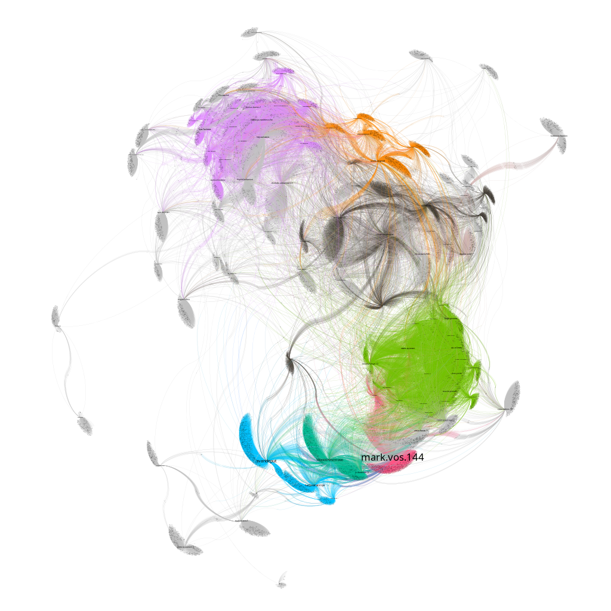

# Noti

## Introduction
The exploration of social graphs is an interesting branch within graph theory, particularly in the context of online social networks. In this project I explored the gathering and mining of social media friendship relationships. 
Due to the sentive nature of using automated programs on social media, the code for this project has been omitted.

At first [Cytoscpe](https://cytoscape.org/) was used to create the graphs, though it started to struggle when the dataset
reached around 20 000 people. Then I switched to [Gephi](https://gephi.org/).

Gephi (headless) was further used to create to create the social graph using a force directed layout with the [ForceAtlas2](https://journals.plos.org/plosone/article?id=10.1371/journal.pone.0098679) algorithm. 
Next, different clustering algorithms where tested to see if different friendgroups could be identified.
Amoung the tested algorithms where: [DB-SCAN](https://en.wikipedia.org/wiki/DBSCAN), [Modularity](https://arxiv.org/abs/0803.0476).

## Visualizaton
One of the visualizations created, containing around 100 000 nodes (profiles) and 90 000 edges (friendship relations).

